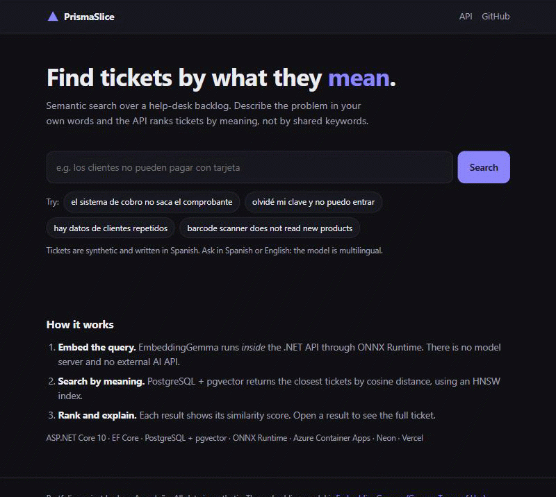
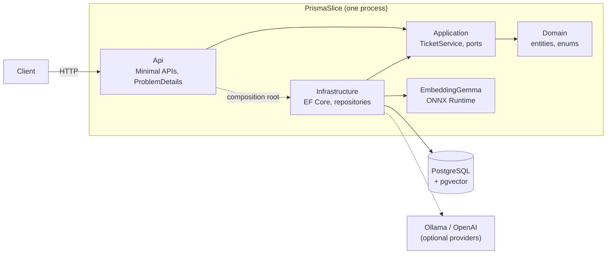
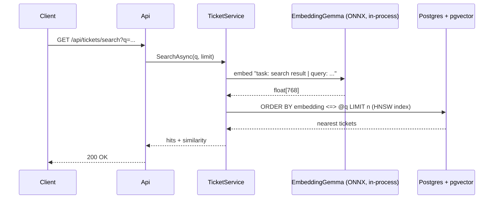

# PrismaSlice

[](https://github.com/JuanAvendan/PrismaSlice/actions/workflows/ci.yml)

**Semantic search for help-desk tickets, built with ASP.NET Core, EF Core and PostgreSQL + pgvector. The embedding model runs inside the API.**

PrismaSlice is a vertical slice of PRISMA, a ticketing system I built and run at work, rebuilt from scratch in .NET with a semantic-search layer on top.
It is a portfolio project. All data is synthetic, and no code or data comes from the original system.

Type what the problem *means* and get back the tickets that match. Finding them doesn't depend on sharing keywords:

| Query | Top result | Similarity |
|---|---|---|
| "el sistema de cobro no saca el comprobante" | La caja 3 no imprime el recibo tras el pago | 0.44 |
| "olvidé mi clave y no puedo entrar" | Restablecer contraseña de usuario bloqueado | 0.44 |
| "hay datos de clientes repetidos" | Duplicación de clientes en el CRM | 0.61 |
| "barcode scanner does not read new products" | El lector de código de barras no reconoce productos nuevos | 0.59 |

*Measured on the seeded data with EmbeddingGemma running in-process through ONNX Runtime. The last query is in English and still finds the Spanish ticket.*



## Quick start

Requires Docker.

```bash
docker compose up --build
```

When the `api` container is up, open **http://localhost:8080/swagger**, or run:

```bash
curl "http://localhost:8080/api/tickets/search?q=los%20clientes%20no%20pueden%20pagar%20con%20tarjeta&limit=3"
```

Compose starts three services in order:

1. Postgres 17 with pgvector.
2. A seed job that applies the migrations, inserts the synthetic catalog and embeds every ticket.
3. The API.

The embedding model is built into the images, so there is no model server and no API key to set up. If port 5432 or 8080 is already in use, set `DB_PORT` or `API_PORT`.

## API

| Method | Route | Description |
|---|---|---|
| `POST` | `/api/tickets` | Validates and saves a ticket, then embeds it. Returns `201` with a database-generated code such as `TCK-00016`. |
| `GET` | `/api/tickets/{code}` | Ticket details: requester, assignee, team, labels, and whether the ticket is indexed. |
| `GET` | `/api/tickets/search?q=&limit=` | Semantic search by cosine similarity. Confidential tickets are never returned. |

Errors come back as [ProblemDetails](https://www.rfc-editor.org/rfc/rfc9457):

- `400` with per-field messages for invalid input.
- `429` when a client goes over the rate limit. The defaults are 30 searches and 5 ticket creations per minute per IP.
- `503` when embeddings are unavailable.

`GET /health` is a liveness probe that doesn't touch the database.

[`PrismaSlice.Api.http`](src/PrismaSlice.Api/PrismaSlice.Api.http) has ready-to-run requests.

## Architecture



The layers follow Clean Architecture:

- **Application** owns the use cases and depends only on two ports, `ITicketRepository` and `IEmbeddingService`.
- **Infrastructure** implements those ports: EF Core and pgvector for persistence, and three embedding providers (in-process ONNX, Ollama and OpenAI).
- **Api** wires everything together and maps errors to HTTP responses.

How a search runs:



## Design decisions

- **The embedding model runs inside the API.** [`OnnxEmbeddingService`](src/PrismaSlice.Infrastructure/Embeddings/OnnxEmbeddingService.cs) runs EmbeddingGemma with ONNX Runtime. Tokenization uses `Microsoft.ML.Tokenizers` with the model's SentencePiece file. There is no model server, no external API, no key and no per-request cost, so the whole app is a single container that can scale to zero.
  - Its vectors match Ollama's version of the same model at a cosine similarity of 0.994–0.996, and the search results are the same.
  - A search takes about 150 ms on CPU once the model is loaded.
- **EmbeddingGemma as the model.** The tickets are in Spanish and EmbeddingGemma is multilingual. It produces 768-dimensional vectors, and the model's retrieval prompts, one for documents and one for queries, are configurable. The int8 export is about 310 MB.
- **pgvector in the main database, not a separate vector store.** Tickets and their embeddings live in the same row, so a search can join relational data directly. An HNSW index with `vector_cosine_ops` keeps the queries fast. The repository writes the query as `ORDER BY ... LIMIT`, which is the form the index can use.
- **Swappable providers.** In-process ONNX (default), Ollama or OpenAI is chosen through configuration, behind `IEmbeddingService`. Every provider checks the vector dimensions so a misconfigured model fails loudly.
- **The AI is optional for writes.** The model loads lazily. If it is missing or fails, a new ticket is still saved, without an embedding, and the event is logged. Search returns `503`. The seed tool fills in missing embeddings later.
- **Reproducible model downloads.** The Dockerfile and the download scripts fetch a pinned revision and verify each file's SHA256.
- **Ready for a public demo.** Per-IP rate limits keep anonymous traffic from using up the free tier or flooding the database. The API ships as a single container that Container Apps scales to zero between visits.
- **Readable ticket codes generated by the database.** A Postgres sequence produces `TCK-00001`, `TCK-00002`, and so on, which stays correct under concurrent inserts.
- **Testing at three levels:**
  - Unit tests for the use cases.
  - API integration tests against a real pgvector container (Testcontainers), with a deterministic hashing embedding service so the ranking can be checked without a model.
  - Tests that run the real ONNX model: vector shape, batch padding, truncation, and whether paraphrased queries find the right ticket.

## Tech stack

- **.NET 10:** ASP.NET Core Minimal APIs and EF Core 10.
- **Database:** PostgreSQL 17 with pgvector (HNSW index), accessed through Npgsql and Pgvector.EntityFrameworkCore.
- **AI:** EmbeddingGemma 300M through ONNX Runtime and Microsoft.ML.Tokenizers. Ollama and OpenAI are optional providers.
- **Tests:** xUnit v3 on Microsoft.Testing.Platform, plus Testcontainers.
- **Infrastructure:** Docker (multi-stage build on chiseled, non-root images) and GitHub Actions.

## Local development

You need the .NET 10 SDK and Docker.

```bash
docker compose up -d db
./scripts/download-model.ps1          # or: sh scripts/download-model.sh  (≈310 MB, verified)
dotnet run --project tools/PrismaSlice.SeedData   # migrations + data + embeddings
dotnet run --project src/PrismaSlice.Api          # http://localhost:5004/swagger
```

The model path, `models/embeddinggemma-300m`, is resolved by walking up from the working directory, so it works both from the repository root and with `dotnet run --project`.

To try the search page locally, serve `web/` on port 5500 (for example `python -m http.server 5500 --directory web`) while the API runs. In Development, the API allows CORS from that origin.

The seed tool is idempotent. Run it again at any time to embed tickets that are missing an embedding.

### Configuration

| Key | Default | Notes |
|---|---|---|
| `ConnectionStrings:Default` | local Postgres | Set in `appsettings.Development.json`. |
| `Embeddings:Provider` | `Onnx` | `Onnx`, `Ollama` or `OpenAI`. |
| `Embeddings:Dimensions` | `768` | Must match the `vector(768)` column. |
| `Embeddings:DocumentPrefix` / `QueryPrefix` | EmbeddingGemma prompts | Used by Onnx and Ollama. |
| `Embeddings:Onnx:ModelDirectory` | `models/embeddinggemma-300m` | |
| `Embeddings:Onnx:MaxTokens` | `512` | Longer texts are truncated; the model supports up to 2048. |
| `Embeddings:Ollama:BaseUrl` / `Model` | `http://localhost:11434` / `embeddinggemma` | Requires `ollama pull embeddinggemma`. |
| `Embeddings:OpenAI:ApiKey` | — | Use user-secrets; never commit it. |

Vectors from different models can't be compared with each other. If you change to a different model, clear the existing embeddings (`UPDATE "Tickets" SET "Embedding" = NULL;`) and run the seed tool again. Switching between Onnx and Ollama doesn't require this, because both run EmbeddingGemma.

### Tests

```bash
dotnet test
```

- The integration tests need Docker, because they start a disposable pgvector container.
- The model tests are skipped if the model hasn't been downloaded. In CI, `REQUIRE_EMBEDDING_MODEL=true` makes them fail instead of skip.

## Deployment

The public demo runs at $0:

- The API, with the model inside, on **Azure Container Apps**, scaling to zero.
- Postgres + pgvector on **Neon**.
- Images on **GitHub Container Registry**.
- The search page in [`web/`](web/) on **Vercel**.

Every merge to `master` is deployed by GitHub Actions, which signs in to Azure with OIDC, so no Azure password is stored in GitHub. Cost controls:

- A monthly budget sends email alerts.
- The **Demo power** workflow switches the public demo off and on from GitHub.

[docs/deploy.md](docs/deploy.md) has the step-by-step guide and the one-time setup script.

## Project structure

```
src/
  PrismaSlice.Domain/          Entities and enums
  PrismaSlice.Application/     Use cases (TicketService), ports, DTOs
  PrismaSlice.Infrastructure/  EF Core, migrations, repository, embedding providers (ONNX, Ollama, OpenAI)
  PrismaSlice.Api/             Minimal API endpoints, error handling
tools/
  PrismaSlice.SeedData/        Migrations + synthetic data + embedding backfill
tests/
  PrismaSlice.UnitTests/
  PrismaSlice.IntegrationTests/
web/                           Static search page (Vercel)
infra/
  azure-setup.ps1              One-time Azure Container Apps + OIDC setup
scripts/
  download-model.ps1 / .sh     Pinned, checksum-verified model download
```

## Roadmap

- [x] Deployment pipeline: Azure Container Apps + Neon + Vercel, inside the free tiers.
- [ ] Authentication with Microsoft Entra ID, with role-based access so agents and clients see different tickets and confidential tickets stay restricted.
- [ ] Hybrid search that combines Postgres full-text ranking with vector similarity.
- [ ] Re-embed a ticket when it is edited.

## Third-party notices

The embedding model is EmbeddingGemma by Google. It is redistributed unmodified and is subject to the [Gemma Terms of Use](https://ai.google.dev/gemma/terms). See [THIRD_PARTY_NOTICES.md](THIRD_PARTY_NOTICES.md).
