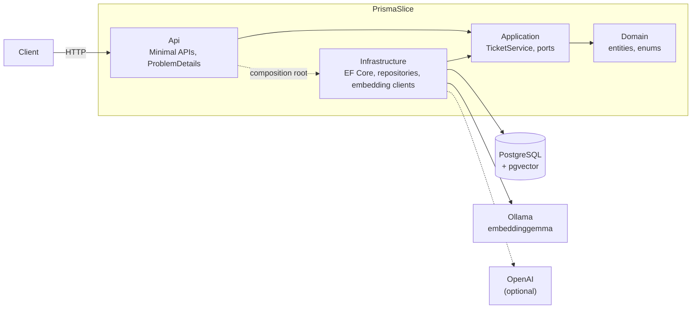
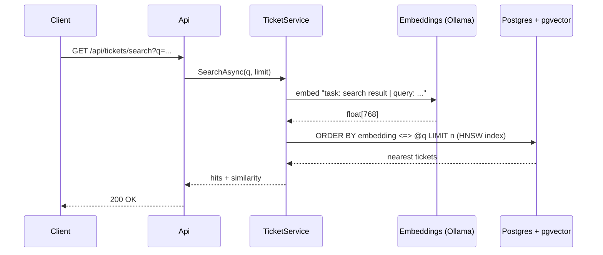

# PrismaSlice

[](https://github.com/JuanAvendan/PrismaSlice/actions/workflows/ci.yml)

**Semantic search for help-desk tickets, built with ASP.NET Core, EF Core and PostgreSQL + pgvector.**

PrismaSlice is a vertical slice of PRISMA, a ticketing system I built and run at work, rebuilt from scratch in .NET with a semantic-search layer on top.
It is a portfolio project. All data is synthetic, and no code or data comes from the original system.

Type what the problem *means* and get back the tickets that match. Finding them doesn't depend on sharing keywords:

| Query | Top result | Similarity |
|---|---|---|
| "el sistema de cobro no saca el comprobante" | La caja 3 no imprime el recibo tras el pago | 0.44 |
| "olvidé mi clave y no puedo entrar" | Restablecer contraseña de usuario bloqueado | 0.44 |
| "hay datos de clientes repetidos" | Duplicación de clientes en el CRM | 0.62 |
| "barcode scanner does not read new products" | El lector de código de barras no reconoce productos nuevos | 0.59 |

*Measured on the seeded data with EmbeddingGemma. The last query is in English and still finds the Spanish ticket.*

## Quick start

Requires Docker.

```bash
docker compose up --build
```

The first run downloads the embedding model, about 620 MB. When the `api` container is up, open **http://localhost:8080/swagger**, or run:

```bash
curl "http://localhost:8080/api/tickets/search?q=los%20clientes%20no%20pueden%20pagar%20con%20tarjeta&limit=3"
```

Compose starts the whole stack in order:

1. Postgres 17 with pgvector.
2. Ollama, which pulls `embeddinggemma` once.
3. A seed job that applies the migrations, inserts the synthetic catalog and embeds every ticket.
4. The API.

If port 5432 or 8080 is already in use, set `DB_PORT` or `API_PORT`.

## API

| Method | Route | Description |
|---|---|---|
| `POST` | `/api/tickets` | Validates and saves a ticket, then embeds it. Returns `201` with a database-generated code such as `TCK-00016`. |
| `GET` | `/api/tickets/{code}` | Ticket details: requester, assignee, team, labels, and whether the ticket is indexed. |
| `GET` | `/api/tickets/search?q=&limit=` | Semantic search by cosine similarity. Confidential tickets are never returned. |

Errors come back as [ProblemDetails](https://www.rfc-editor.org/rfc/rfc9457):

- `400` with per-field messages for invalid input.
- `503` when the embedding provider is unavailable.

[`PrismaSlice.Api.http`](src/PrismaSlice.Api/PrismaSlice.Api.http) has ready-to-run requests.

## Architecture



The layers follow Clean Architecture:

- **Application** owns the use cases and depends only on two ports, `ITicketRepository` and `IEmbeddingService`.
- **Infrastructure** implements those ports with EF Core and pgvector, plus an HTTP client for each embedding provider.
- **Api** wires everything together and maps errors to HTTP responses.

How a search runs:



## Design decisions

- **pgvector in the main database, not a separate vector store.** Tickets and their embeddings live in the same row, so a search can join relational data directly. An HNSW index with `vector_cosine_ops` keeps the queries fast. The repository writes the query as `ORDER BY ... LIMIT`, which is the form the index can use.
- **EmbeddingGemma as the default model.** The tickets are in Spanish. `nomic-embed-text` is mostly English, while EmbeddingGemma is multilingual. Both produce 768-dimensional vectors, so the schema stayed the same. The model's retrieval prompts, one for documents and one for queries, are configurable.
- **Swappable providers.** Ollama or OpenAI is chosen through configuration, behind `IEmbeddingService`. Both clients check the vector dimensions so a misconfigured model fails loudly.
- **The AI is optional for writes.** If the embedding provider is down, a new ticket is still saved, without an embedding, and the event is logged. Search returns `503`. The seed tool fills in missing embeddings when the provider comes back.
- **Readable ticket codes generated by the database.** A Postgres sequence produces `TCK-00001`, `TCK-00002`, and so on, which stays correct under concurrent inserts.
- **Tests run without an AI model.** The integration tests run the real API against a real pgvector container (Testcontainers). Embeddings come from a deterministic bag-of-words hashing service, which still lets them check the search ranking end to end.

## Tech stack

- **.NET 10:** ASP.NET Core Minimal APIs and EF Core 10.
- **Database:** PostgreSQL 17 with pgvector (HNSW index), accessed through Npgsql and Pgvector.EntityFrameworkCore.
- **Embeddings:** Ollama running EmbeddingGemma, with OpenAI as an optional provider.
- **Tests:** xUnit v3 on Microsoft.Testing.Platform, plus Testcontainers.
- **Infrastructure:** Docker (multi-stage build on chiseled, non-root images) and GitHub Actions.

## Local development

You need the .NET 10 SDK, Docker and [Ollama](https://ollama.com).

```bash
docker compose up -d db
ollama pull embeddinggemma
dotnet run --project tools/PrismaSlice.SeedData   # migrations + data + embeddings
dotnet run --project src/PrismaSlice.Api          # http://localhost:5004/swagger
```

The seed tool is idempotent. Run it again at any time to embed tickets that are missing an embedding.

### Configuration

| Key | Default | Notes |
|---|---|---|
| `ConnectionStrings:Default` | local Postgres | Set in `appsettings.Development.json`. |
| `Embeddings:Provider` | `Ollama` | `Ollama` or `OpenAI`. |
| `Embeddings:Dimensions` | `768` | Must match the `vector(768)` column. |
| `Embeddings:Ollama:Model` | `embeddinggemma` | |
| `Embeddings:Ollama:DocumentPrefix` / `QueryPrefix` | EmbeddingGemma prompts | Change these if you switch models. |
| `Embeddings:OpenAI:ApiKey` | — | Use user-secrets; never commit it. |

To use OpenAI instead of Ollama:

```bash
dotnet user-secrets set "Embeddings:OpenAI:ApiKey" "<your-key>" --project src/PrismaSlice.Api
```

Then set `Embeddings:Provider` to `OpenAI`.

Vectors from different models can't be compared with each other. If you change the provider or the model, clear the existing embeddings (`UPDATE "Tickets" SET "Embedding" = NULL;`) and run the seed tool again.

### Tests

```bash
dotnet test
```

The unit tests cover `TicketService`: validation, the fallback when embeddings fail, and query versus document prompts. The integration tests need Docker, because they start a disposable pgvector container.

## Project structure

```
src/
  PrismaSlice.Domain/          Entities and enums
  PrismaSlice.Application/     Use cases (TicketService), ports, DTOs
  PrismaSlice.Infrastructure/  EF Core, migrations, repository, embedding clients
  PrismaSlice.Api/             Minimal API endpoints, error handling
tools/
  PrismaSlice.SeedData/        Migrations + synthetic data + embedding backfill
tests/
  PrismaSlice.UnitTests/
  PrismaSlice.IntegrationTests/
```

## Roadmap

- [ ] Deploy to Azure Container Apps, with Neon for Postgres, inside the free tiers.
- [ ] Authentication with Microsoft Entra ID, with role-based access so agents and clients see different tickets and confidential tickets stay restricted.
- [ ] Hybrid search that combines Postgres full-text ranking with vector similarity.
- [ ] Re-embed a ticket when it is edited.
